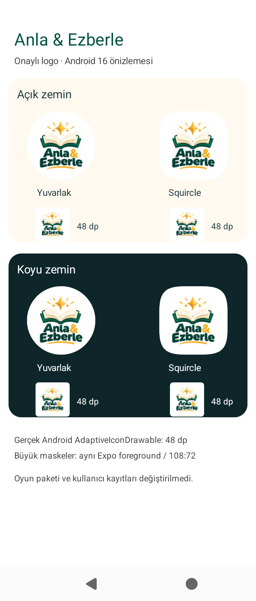
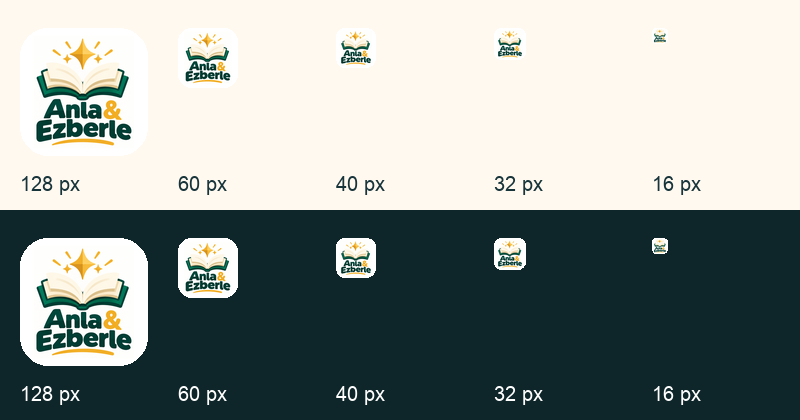

# Approved logo integration — 31 October 2026

## Scope and base

Feature branch `feat/approved-education-logo-20261031` is based on the current closed-test preparation branch (PR #20, `ca48a781d63a8de5831a979fe4f785d519973b36`). Current `origin/main` was checked (`b0d5c38`); open PR #13/#17/#18/#20 were inspected before starting. This is a focused follow-up to PR #20, preserving its runtime fixes and the #17 → #18 → #20 integration chain.

The source is the exact owner-approved PNG, with no redesign. [Source, generation instructions and hashes](../../assets/branding/README.md). The white border alone was cropped; all coloured artwork and text remain. No gameplay, home UI, database, advertising runtime, user data, identity, signing or release version change is included.

## Changed files

- `assets/branding/approved-education-logo.png`: immutable supplied source; provenance and output hashes next to it.
- `assets/images/icon.png`, `adaptive-foreground.png`, `splash-mark.png`, `favicon.png`: proportionally resized/padded derivatives.
- `store/google-play/icon-512.png`: complete opaque 512×512 PNG, ready for later separately approved store upload.
- `app.json`: explicit iOS icon path; white adaptive/native splash backgrounds to match the source's opaque white background. Bundle IDs, URL scheme, EAS project, permissions and plugins remain unchanged.
- `scripts/generate-brand-assets.mjs` / `.py`: existing generation entry point now regenerates from the approved PNG rather than the old SVG; development-only Pillow, no runtime dependency.
- `tests/brand-identity.test.ts`: current background expectations and platform/favicon dimensions.
- This report and actual preview captures.

## Technical validation

- `pnpm check`: **PASS**, question integrity, TypeScript, lint and **378/378 tests**, zero failures/skips.
- `pnpm export:web`: **PASS**; new favicon exported to `dist/favicon.ico`.
- Expo `prebuild --no-install`: **PASS**, both Android and iOS native resources generated locally (ignored native directories, not committed).
- Generated iOS AppIcon catalog: 1024×1024, RGB, no transparency, pixel-for-pixel match to the configured app icon. This is catalog validation, **not physical iPhone or signed iOS build acceptance**.
- Android generated `ic_launcher`, `ic_launcher_round`, adaptive foreground mipmaps and adaptive XML: generated successfully, matching white `iconBackground`.
- Generator `--check`: **PASS**, deterministic byte/hash match and coloured-pixel geometry entirely inside Android's central 66/108 safe circle. Source file matches the owner's original byte-for-byte.
- PNG dimensions and complete opacity validated for iOS and Play; source proportions preserved. No pre-rounded store icon corners.

## Actual Android emulator preview

[Actual Android emulator capture](android-icon-preview-360.png) uses the Expo-generated Android mipmaps in an isolated local native preview APK (`com.kovynelstudio.iconpreview`). Emulator: Android 16 / API 36, arm64, 720×1688 at 320 dpi (**360 dp width**). There are no network permissions or online accounts in this preview.

The 48 dp icons use Android's actual `ApplicationInfo.loadIcon` / `AdaptiveIconDrawable` rendering. The larger circle and squircle views explicitly apply those mask shapes to the same generated adaptive foreground with the Android 108:72 viewport ratio. Both light and dark surrounding surfaces are shown in the same actual native screenshot. No book, star, underline or wordmark clipping was observed. No themed monochrome replacement was added because the approved colours must remain.

This is an **icon-only native preview**, not a newly compiled or signed Anla & Ezberle game APK. The installed game package and its records were not modified or uninstalled. Full game installation, cold-start splash timing, physical Samsung launcher and physical iPhone acceptance remain for a later approved native build.

[Small-size/iOS mask sheet](ios-and-small-size-preview.png) is a **generated inspection sheet**, not an iPhone screenshot. At 60–128 px the complete logo is readable; at 40–48 px the wordmark is small, and at 16–32 px the text cannot be fully read. The supplied design is kept intact rather than silently removing text or inventing a simplified replacement. All sizes preserve the book/star silhouette and colours.

## Release boundary

No AAB was produced/uploaded, no EAS Update or Play/store listing release was sent, no PR was merged into main and no Vercel Production deployment was performed. The currently published Alpha remains unchanged. Supabase, real/test advertising configuration, Analytics and user data were not touched. New icon activation on installed phones requires a later approved native build; Metro/Fast Refresh alone cannot replace a launcher icon.

