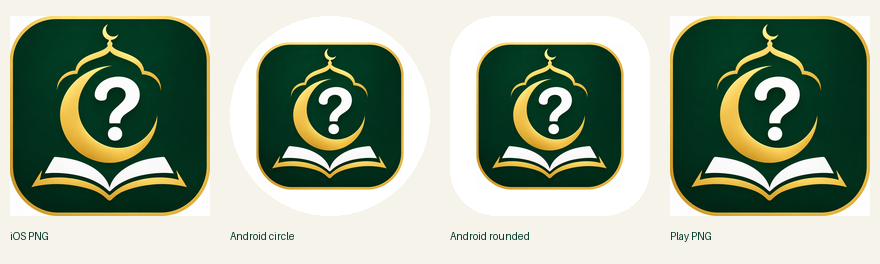
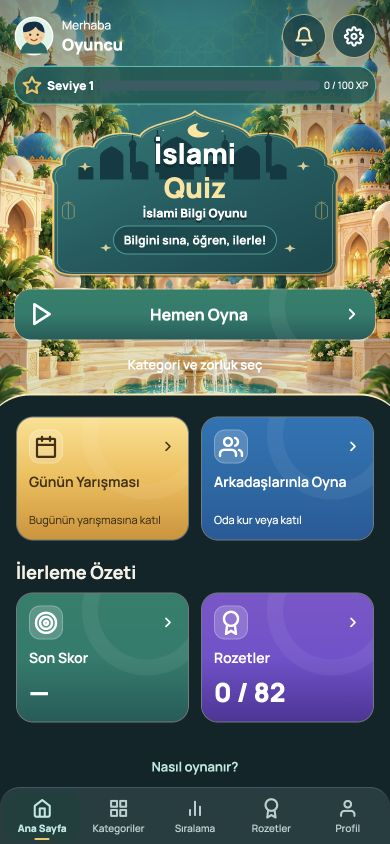

# 0.1.2 — İslami Quiz adı ve sahibinin yeni logosu

27 Kasım 2026. Aynı `integration/ios011-native-source-20261126` dalı;
başlangıç `34e2510`, reklam döngüsü düzeltmesi `6816a42` korunur.
Bu çalışma ayrı sürüm, main merge, IPA, cihaz kurulumu, mağaza gönderimi veya
canlı backend değişikliği yapmaz. Mevcut sürüm/build numaraları değiştirilmedi;
planlanan 0.1.2 paketinin isim/ikon girdileri hazırlanır.

## Güncellenen alanlar

- `app.json`: Expo ve web görünen adı **İslami Quiz**.
- `src/branding/identity.ts`: uygulama içi merkezi ad ve iki satırlı başlık.
- Ana sayfa plaketi, tema önizlemesi, e-posta giriş alt başlığı, çevrimiçi
  ekran, sonuç paylaşımı, oda daveti, bildirim ayarlarına yönlendirme,
  hesap silme ekranının adı/destek konu satırı, yardım ve gizlilik kimlik satırı.
- `app.config.ts`: iOS `CFBundleDisplayName`; iOS/Android/web/splash ikonları
  merkezi `config/brand-assets.json` çıktılarından alınır.
- `store/app-store/tr-TR/listing.json`: 0.1.2 için yeni isimli yerel taslak.
  Tam açıklama, bugün Apple'ın herkese açık 0.1.1 kaydından alınarak yalnız
  ilk ürün adı “İslami Quiz (Anla & Ezberle)” yapılmıştır. Önceki alt başlık
  ve anahtar kelime taslağı korunur; Connect'teki güncel özel alanlar veya
  yeni adın kullanılabilirliği doğrulanmış sayılmaz.
- `store/google-play/tr-TR/listing.json`: başlık ve açıklamadaki ilk ürün adı;
  kısa açıklama ve diğer içerik korunur. Bu dosya yerel taslaktır.

Destek, gizlilik ve Marketing URL değişmedi. “Anla & Ezberle” Yardım ekranı,
gizlilik kimlik satırı ve iki mağaza açıklamasında marka geçmişi olarak kalır.
Kovynel Studio uygulama/telif markası korunur; Apple'ın bireysel hesap
satıcı/geliştirici kimliği veya Google Play geliştirici hesabı değiştirilmedi.

Bundle ID resolver'ı, Android package, Expo slug/scheme/project ID, OAuth
client ve callback'ler, AdMob App ID/birim çözümleyicisi, SecureStore/AsyncStorage
anahtarları ve Supabase ayarları korunur. 3.000 soru, XP, Hemen Oyna ve mevcut
reklam döngüsü kaynakları byte düzeyinde başlangıçla karşılaştırıldı.

## Sağlanan logo ve tek kaynak

Sahibinin bu konuşmada paylaştığı PNG, yeniden çizilmeden
`assets/branding/islami-quiz-logo.png` olarak byte-for-byte kopyalandı.
Kaynak 1254×1254, RGB, opak; renk değerleri korunur. Üretim yalnız tam kaynak
karesinin orantılı küçültülmesi ve Android için güvenli ortalamadır.
Kesme, yeniden renklendirme, arka plan kaldırma veya yeni tasarım yoktur.

`config/brand-assets.json` kaynak, onaylı SHA256, tam kaynak dikdörtgeni,
Android yerleşimi ve bütün aktif çıktı yollarını yönetir. SHA kontrolü,
yeni bir resme eski kırpma değerlerinin sessizce uygulanmasını engeller.
`scripts/generate-brand-assets.py --check` byte düzeyinde yeniden üretilebilir
çıktıları ve Android güvenli alanını doğrular. Pillow 11.3.0 yalnız mevcut
export betiğinin geliştirme bağımlılığıdır; uygulamaya native paket eklenmedi.

| Çıktı                                   | Format / boyut                          | Kullanım                    |
| --------------------------------------- | --------------------------------------- | --------------------------- |
| `assets/images/icon.png`                | 1024×1024 RGB PNG, opak, sRGB           | Expo / iOS / eski Android   |
| `assets/images/adaptive-foreground.png` | 1024×1024 RGBA PNG                      | Android adaptive foreground |
| `assets/images/splash-mark.png`         | 1024×1024 RGB PNG                       | Mevcut splash plugin'i      |
| `assets/images/favicon.png`             | 64×64 RGB PNG                           | Web favicon                 |
| `store/google-play/icon-512.png`        | 512×512 32-bit PNG, sRGB, <1024 KB      | Play mağazası               |
| `assets/store/play-store-icon-512.png`  | Yukarıdaki Play dosyasının aynı çıktısı | Eski teslim yolunun uyumu   |

Sağlanan görsel zaten yuvarlatılmış altın bir çerçeve içeriyor; bu tasarım
korundu. Android katmanında tüm renkli çizimin merkezi 66/108 güvenli dairede
kalması doğrulanır. Arka plan mevcut beyazdır. Kaynak opak olduğundan ayrı
şeffaf çizim/cutout uydurulmadı. Ayrı dark/light/monochrome varyant eklenmedi.

Önceki onaylı logo ve eski SVG dosyaları arşiv/referans olarak korunur;
aktif üretim ve Expo/native ikon yolları artık yeni kaynağın çıktılarıdır.
Native asset catalog veya mipmap klasörleri kaynak doğruluk noktası değildir:
CNG prebuild sırasında Expo bu girdilerden gerekli boyutları üretmelidir.
Eski QA native paketini yalnız JS değiştirerek kullanmak yeni launcher adı
ve ikonunun native kabulü olarak sunulamaz.

Yeni bir teslim gerekirse ana dosya en az 1024×1024 kare sRGB PNG olmalı.
iOS raster ikonu opak olmalı; Android için ayrıca çerçevesiz/şeffaf foreground
verilebilir. Play teslimi 512×512 32-bit PNG ve en fazla 1024 KB'dir.
JPEG ekran görüntüsü, önizleme veya rastgele placeholder ikon kaynağı değildir.

## Kontroller ve sınırları

- 57 hedefli kimlik, native Google/Apple, UMP/ATT, reklam ve ardışık tur testi geçti.
- Son opak RGB / 32-bit Play / boyut kontrolleriyle aynı iki marka testi tekrar
  2/2 geçti; bunlar 57'ye ilave iki farklı test değildir.
- TypeScript ve değişen TS/TSX/MJS dosyalarının ESLint kontrolü geçti.
- Deterministik export `--check`, kaynak SHA ve bütün aktif ikon yolları geçti.
- Expo native introspection: iOS `CFBundleDisplayName = İslami Quiz`, Android
  `app_name = İslami Quiz`; registered iOS ve Android paket kimlikleri korunur.
- Web export geçti. Gerçek çalışan yerel web arayüzü 320 ve 390 px'de yeni
  başlıkla kontrol edildi; yatay taşma yok. Yardım ekranı eski marka izini gösterir.
- **Bu yeni ad/ikonla native derleme ve fiziksel iPhone/Android testi yapılmadı.**
  Önceki fiziksel reklam testi bu markalama değişikliğinin cihaz kabulü değildir.
  Yeni Google/Apple giriş oturumu da bu görevde açılmadı; regresyonlar otomatik
  test ve kaynak/config karşılaştırmasıyla doğrulandı.

## Mağaza ve teslim durumu

Apple'ın bugün okunan resmî herkese açık kaydı hâlâ 0.1.1 ve
“Anla & Ezberle: İslami Quiz” adındadır. Canlı mağaza metadata'sı kaydedilmedi,
yayımlanmadı veya incelemeye gönderilmedi. Google Play Alpha, uygulama kaydı
ve testçileri değiştirilmedi. Yeni adın mağaza tarafından kabulü / benzersizliği
sonraki 0.1.2 Console hazırlığında doğrulanmalıdır.

Kod ve asset değişikliği aynı 0.1.2 adayına dahil edilebilir. Sonraki paket
adımında yeni girdilerden native ikon/launcher adı üretilip cihazda kabul
edilmeli; son mağaza metinleri/screenshot'lar yeni adla eşleştirilmelidir.
Main merge ve mağaza gönderimi için sahibinin mevcut ayrı onay sınırları sürer.
Reklam QA'sındaki ek üç gösterim atlamasının nedeni bu markalama görevinde
çözülmüş veya test edilmiş sayılmaz.

## Resmî gereksinimler

- [Expo app name / icon configuration](https://docs.expo.dev/versions/latest/config/app/)
- [Expo raster icon ve native export](https://docs.expo.dev/develop/user-interface/splash-screen-and-app-icon/)
- [Apple app icon — build ve yeni sürüm süreci](https://developer.apple.com/help/app-store-connect/manage-app-information/add-an-app-icon/)
- [Google Play icon: 512 px, PNG, sRGB, boyut sınırı](https://developer.android.com/distribute/google-play/resources/icon-design-specifications)
